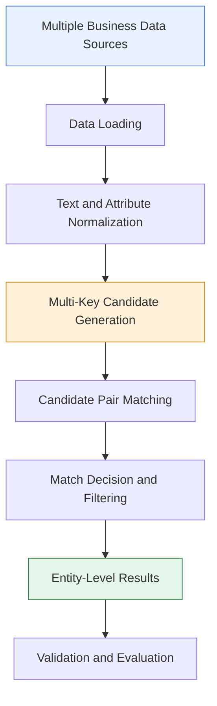

# ML Business Entity Resolution
### Scalable Record Linkage · Intelligent Matching · Data Quality Engineering

An end-to-end Python project for identifying and matching business records that refer to the same real-world entity across multiple data sources.

Business information is often inconsistent: company names may contain abbreviations, addresses may be formatted differently, and the same organization may appear multiple times with variations in its attributes. This project explores a practical entity-resolution pipeline that combines text normalization, multi-key candidate generation, and matching strategies to improve record linkage at scale.

> **Project focus:** Large-scale business record matching, candidate generation, precision-oriented evaluation, and efficient data processing.

## Overview

Entity resolution is the process of determining whether two or more records represent the same real-world entity, even when their attributes are not identical.

This project was developed as part of the **ML Challenge 2026 Business Entity Resolution** task. It explores techniques for matching business entities across multiple data sources while managing the computational cost of comparing millions of records.

### Key engineering challenges

- **Inconsistent business data:** Names and addresses can differ in spelling, formatting, abbreviations, and structure.
- **Large-scale matching:** Exhaustively comparing every possible pair becomes computationally expensive.
- **Candidate recall:** The candidate-generation stage must retain likely matches instead of discarding them too early.
- **False-positive control:** Incorrect matches can reduce the reliability of the final output.
- **Evaluation at scale:** Matching quality must be measured using appropriate metrics rather than accuracy alone.

## System Architecture



### Pipeline stages

1. **Data ingestion:** Load business records from the supplied challenge datasets.
2. **Normalization:** Standardize relevant text fields to reduce superficial differences.
3. **Candidate generation:** Use multiple blocking keys to reduce the number of pairs requiring detailed comparison.
4. **Matching:** Apply the implemented matching rules and comparison logic to identify likely entity matches.
5. **Result generation:** Produce entity-matching outputs in the challenge's expected format.
6. **Validation:** Check submission structure and evaluate matching quality using precision, recall, and F-score metrics.

## Technical Approach

### 1. Text normalization

Normalization reduces irrelevant differences between business records before comparison.

Examples of potential variations include capitalization, punctuation, spacing, and inconsistent text formatting. Normalization helps make comparable records easier to identify.

### 2. Multi-key blocking

Comparing every record with every other record is expensive. Blocking narrows the search space by generating candidates that share selected characteristics.

The implemented approach explores multiple blocking keys based on business-name information, including prefixes and initial tokens, alongside other available attributes.

Using multiple blocking strategies helps retain candidates that a single strict key might miss.

### 3. Candidate matching

Candidate generation and final matching are separate stages. Generating a candidate means that a pair is worth evaluating; it does not automatically establish that both records represent the same entity.

The pipeline uses implemented matching and filtering logic to produce candidate matches and entity-level results.

### 4. Evaluation-driven development

The project evaluates the trade-off between precision and recall. This is important because an overly restrictive system can produce highly precise results while missing many genuine matches.

The reported metrics below refer to a local validation run of the V3 pipeline, not a verified final competition score.

## Evaluation Results

The following results were recorded during local V3 validation:

| Metric | Result |
|---|---:|
| Precision | 98.33% |
| Recall | 24.57% |
| Micro F0.5 | 61.44% |
| Macro F0.5 | 40.89% |

*Values are rounded from the recorded validation results.*

### Interpretation

- **High precision:** The evaluated predictions were usually correct.
- **Low recall:** Many genuine matches were not recovered.
- **F0.5 evaluation:** F0.5 weights precision more heavily than recall, making it useful when false-positive matches are particularly costly.

These results reveal an important engineering trade-off: high precision alone does not guarantee a strong entity-resolution system. Improving recall without introducing too many incorrect matches remains a key optimization opportunity.

**Validation note:** These are V3 local validation metrics. They should not be interpreted as the team's final submission score or a public leaderboard result.

## Technology Stack

- **Language:** Python
- **Data processing:** pandas
- **Candidate matching and text similarity:** Rule-based matching and text-processing techniques
- **Supporting libraries:** RapidFuzz, scikit-learn, and Unidecode were used in the project workflow
- **Development tools:** Visual Studio Code, Git, and GitHub
- **Validation:** Python-based submission validation utilities

## Repository Structure

```text
ML-Business-Entity-Resolution/
├── README.md
├── .gitignore
└── student_resource/
    ├── README.md
    ├── Documentation_template.md
    ├── entity_resolution.py
    ├── final_pipeline.py
    ├── final_pipeline_v1.py
    ├── final_pipeline_v2.py
    ├── final_pipeline_v3.py
    ├── final_submission.py
    ├── final_submission_v2.py
    ├── final_submission_v3.py
    ├── final_submission_v4.py
    └── utils/
        └── validate_submission.py
```

The repository contains the principal Python implementations and validation utility. Challenge datasets, generated output files, and the local database are intentionally excluded from GitHub.

## Getting Started

### Prerequisites

- Python 3.10 or a compatible version
- Git
- The required Python packages
- Access to the challenge datasets, if reproducing the original workflow

### Clone the repository

```bash
git clone https://github.com/RohithaKavala/ML-Business-Entity-Resolution.git
cd ML-Business-Entity-Resolution
```

### Set up a virtual environment

**Windows PowerShell**

```powershell
python -m venv .venv
.\.venv\Scripts\Activate.ps1
```

### Install dependencies

The original workflow used pandas, RapidFuzz, scikit-learn, and Unidecode. Install the packages required by the specific script you intend to run:

```bash
python -m pip install pandas rapidfuzz scikit-learn unidecode
```

### Run the pipeline

Start by reviewing the script's configuration and input-path requirements:

```bash
python student_resource/entity_resolution.py
```

The original challenge workflow depends on dataset files and configuration that are not included in this public repository. Reproduction may require restoring the permitted input files and adjusting paths to match your local environment.

## Engineering Principles

This project explores several practical principles of large-scale data matching:

- Reduce the candidate search space before expensive comparisons.
- Normalize data before applying similarity or matching rules.
- Treat candidate generation and final matching as separate responsibilities.
- Evaluate precision and recall together.
- Validate output schemas and required identifiers.
- Keep large datasets and generated artifacts separate from source control.

## Reproducibility and Data

The challenge datasets and generated results are not distributed with this repository. This keeps the repository focused on source code and documentation and avoids publishing large challenge artifacts.

Use only datasets you are authorized to access and redistribute. Reproducing the reported evaluation results requires the corresponding validation data, matching implementation, and evaluation procedure.

## Author

**Rohitha Kavala**

GitHub: [@RohithaKavala](https://github.com/RohithaKavala)

Repository: [ML Business Entity Resolution](https://github.com/RohithaKavala/ML-Business-Entity-Resolution)

---

*Built to explore scalable entity matching, data quality, and precision-recall trade-offs in real-world-style business data.*
